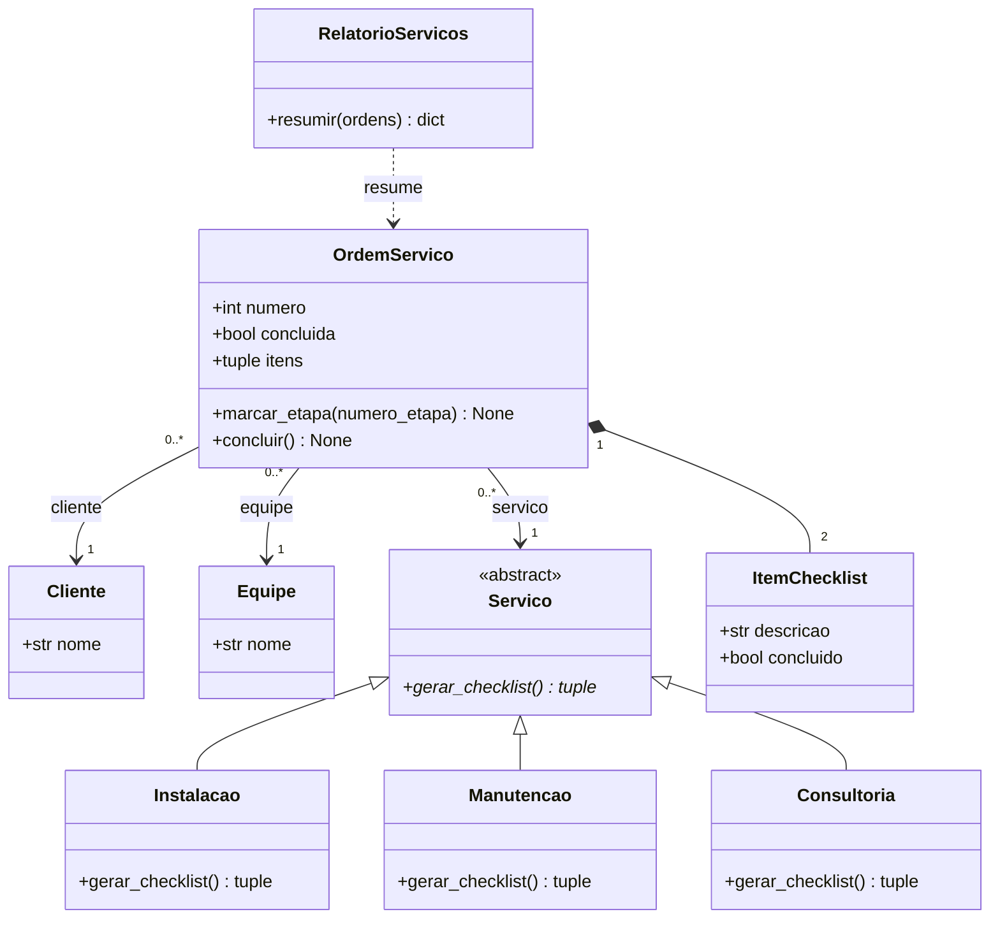

# JAM-DF | Desk App III

JAM-DF - empresa de segurança eletrônica. Cada ordem liga um cliente a uma equipe e tem um checklist de
instalação, manutenção ou consultoria. A ordem só pode ser concluída quando
todas as suas etapas estiverem marcadas.

O menu roda no terminal. O SQLite guarda clientes, equipes, ordens de serviço
e o progresso dos checklists entre execuções.

## Executar

Use Python 3.10 ou superior. O projeto usa apenas a biblioteca padrão.

```sh
python main.py
```

O menu oferece cadastro e consulta de clientes e equipes, consulta dos três
tipos de serviço, abertura de ordens, listagem com checklists, controle de
etapas, conclusão de ordens e relatório por status. Cadastre um cliente e uma
equipe antes de abrir a primeira ordem. Use os números exibidos nas listas
para selecionar os registros.

O programa cria `jam_df.sqlite3` na pasta do projeto no primeiro uso. Para usar
um arquivo separado, indique o caminho com `--banco`.

```sh
python main.py --banco exemplo.sqlite3
```

Ao reabrir o mesmo arquivo, as listas e o relatório recuperam os dados
salvos. Para rodar os testes da modelagem, do menu e da persistência, execute o comando abaixo.

```sh
python -m unittest -v
```

O script `python demo.py` executa a demonstração automática da modelagem do
Desk App I.

## Diagrama de classes UML



| Conceito | Onde aparece |
| --- | --- |
| Herança | Os três tipos de serviço herdam de `Servico`. |
| Polimorfismo | `OrdemServico` chama `gerar_checklist()` e cada subtipo fornece suas próprias etapas. |
| Composição | A ordem cria e possui os itens do seu checklist. Os três serviços implementados têm duas etapas cada. |
| Associação | Cada ordem referencia um cliente, uma equipe e um serviço. Esses objetos podem ser compartilhados por várias ordens. |
| Dependência | `RelatorioServicos.resumir()` recebe ordens como argumento e usa seus status para calcular os totais. |

