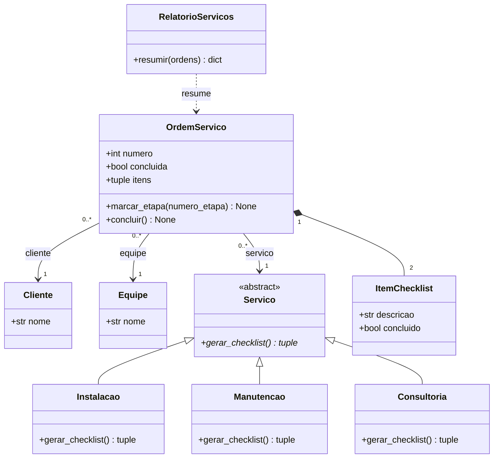

# JAM-DF | Desk App I

Modelo em Python para acompanhar ordens de serviço de uma empresa de segurança
eletrônica. Cada ordem liga um cliente a uma equipe e tem um checklist de
instalação, manutenção ou consultoria. A ordem só pode ser concluída quando
todas as suas etapas estiverem marcadas.

## Executar

Use Python 3.10 ou superior. O projeto usa apenas a biblioteca padrão.

```sh
python demo.py
python -m unittest -v
```

O script abre três ordens, mostra seus checklists, tenta concluir uma ordem
com etapa pendente, finaliza essa ordem e imprime o relatório. O resultado
esperado é **2 ordens abertas e 1 concluída**.

## Diagrama de classes UML



| Conceito | Onde aparece |
| --- | --- |
| Herança | Os três tipos de serviço herdam de `Servico`. |
| Polimorfismo | `OrdemServico` chama `gerar_checklist()` e cada subtipo fornece suas próprias etapas. |
| Composição | A ordem cria e possui os itens do seu checklist. Os três serviços implementados têm duas etapas cada. |
| Associação | Cada ordem referencia um cliente, uma equipe e um serviço. Esses objetos podem ser compartilhados por várias ordens. |
| Dependência | `RelatorioServicos.resumir()` recebe ordens como argumento e usa seus status para calcular os totais. |

