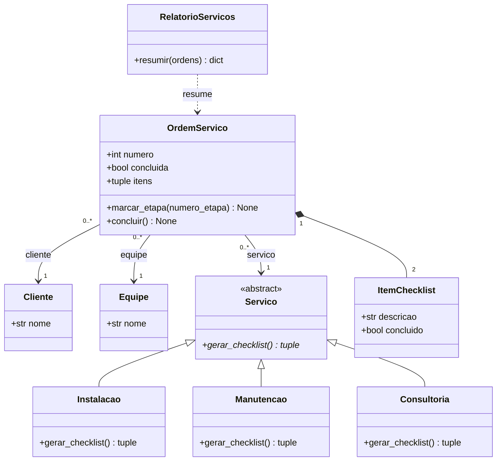

# JAM-DF | Desk App IV

JAM-DF - empresa de segurança eletrônica. Cada ordem liga um cliente a uma equipe e tem um checklist de
instalação, manutenção ou consultoria. A ordem só pode ser concluída quando
todas as suas etapas estiverem marcadas.

A interface gráfica usa Tkinter. O SQLite guarda clientes, equipes, ordens de
serviço e o progresso dos checklists entre execuções.

## Executar

Use Python 3.10 ou superior e execute o comando em um ambiente com interface
gráfica.

```sh
python interface.py
```

Para verificar se o seu Python inclui Tkinter, execute `python -m tkinter`.
Se o módulo estiver faltando no Ubuntu ou Debian, instale o pacote
`python3-tk` para o Python do sistema.

Use **Clientes** e **Equipes** para cadastrar os responsáveis pela ordem.
A área **Tipos de serviço** mostra os três checklists. Em **Ordens de serviço**,
clique em **Nova ordem** para vincular um cliente, uma equipe e um tipo de
serviço. Selecione a ordem e a etapa antes de clicar em **Marcar etapa**.
Os indicadores de ordens abertas e concluídas são atualizados após as operações.

## Banco de dados e testes

A interface e a versão de terminal (`python main.py`) usam o mesmo arquivo
`jam_df.sqlite3` na pasta do projeto. As duas aceitam `--banco` para indicar
outro arquivo.

```sh
python interface.py --banco exemplo.sqlite3
python -m unittest -v
```

Os testes cobrem a modelagem, o menu, a persistência e a interface. O teste
gráfico requer um ambiente com Tkinter e uma tela disponível.
O script `python demo.py` executa a demonstração da modelagem do Desk App I.

## Diagrama de classes UML



| Conceito | Onde aparece |
| --- | --- |
| Herança | Os três tipos de serviço herdam de `Servico`. |
| Polimorfismo | `OrdemServico` chama `gerar_checklist()` e cada subtipo fornece suas próprias etapas. |
| Composição | A ordem cria e possui os itens do seu checklist. Os três serviços implementados têm duas etapas cada. |
| Associação | Cada ordem referencia um cliente, uma equipe e um serviço. Esses objetos podem ser compartilhados por várias ordens. |
| Dependência | `RelatorioServicos.resumir()` recebe ordens como argumento e usa seus status para calcular os totais. |

